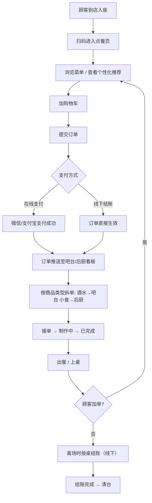
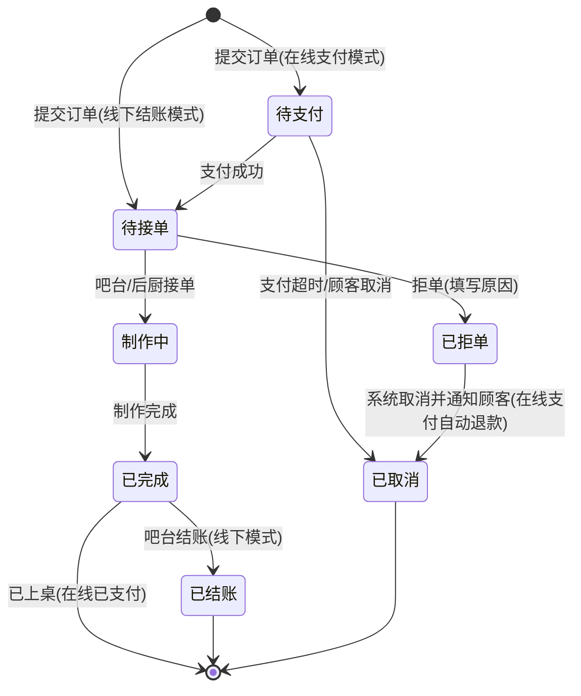

# MiriBar 在线扫码点餐系统 — 产品需求文档（PRD）

| 项目 | 内容 |
| --- | --- |
| 产品名称 | MiriBar 在线扫码点餐系统 |
| 文档版本 | v1.0 |
| 编写日期 | 2026-10-27 |
| 状态 | 评审稿 |
| 目标读者 | 产品、研发、测试、运营、商家 |

---

## 1. 项目概述

### 1.1 背景与目标

现代酒吧场景（含 Livehouse、餐酒吧）在营业高峰期普遍面临以下痛点：

- 人工点单效率低：顾客需等待服务员或到吧台排队点单，高峰期流失订单；
- 传单易出错：口头/手写传单易漏单、错单，吧台与后厨信息不同步；
- 缺乏数据沉淀：无法掌握顾客偏好、热销商品与时段规律，营销靠经验。

**产品目标**：为酒吧提供一套"扫码即用"的智能点餐解决方案——顾客扫码进入点餐界面（无需下载 APP），实时浏览菜单与个性化推荐，下单后自动同步至吧台/后厨看板，减少人工传递时间、提升出餐效率，并通过订单数据反哺经营决策。

### 1.2 产品形态

| 端 | 形态 | 使用者 | 说明 |
| --- | --- | --- | --- |
| 顾客端 | H5 网页 + 微信小程序 | 顾客 | 扫码直接进入，无需下载 APP |
| 吧台/后厨端 | Web 管理界面（平板/PC） | 吧台员工、后厨 | 实时订单看板，接单与制作状态流转 |
| 商家管理端 | Web 管理界面（PC） | 店长、平台管理员 | 商品、营销、桌台、员工、报表管理 |

### 1.3 术语表

| 术语 | 定义 |
| --- | --- |
| 桌台 | 酒吧内一张可点单的桌子/卡座，每桌有唯一桌码 |
| 桌码 | 印在桌台上的二维码，内含门店与桌台标识，顾客扫码进入点餐 |
| SKU / 多规格 | 同一商品的不同规格（如杯型、冰量、份量），可独立定价与售罄 |
| 看板（KDS 屏） | 吧台/后厨用于查看与流转订单状态的实时屏幕 |
| 加单 | 顾客在同一桌已完成一单后再次下单，追加到本桌账单 |
| 并桌 | 两张及以上桌台合并结算 |
| 拆单 | 同一订单按商品类型拆分为酒水单（吧台）与小食单（后厨） |
| 埋点 | 记录顾客浏览、点击、下单行为的数据采集点，供推荐算法使用 |

### 1.4 用户角色

| 角色 | 说明 |
| --- | --- |
| 顾客 | 扫码浏览菜单、下单、支付、跟踪订单 |
| 吧台员工 | 查看酒水单、接单、制作、出餐、线下结账 |
| 后厨员工 | 查看小食单、接单、制作、出餐 |
| 店长 | 管理商品、营销活动、员工、查看经营报表 |
| 平台管理员 | 管理门店、角色权限、系统配置、审计 |

---

## 2. 总体业务流程

### 2.1 主流程

### 2.2 订单状态机

---

## 3. 功能需求

优先级定义：**P0** = MVP 必须具备；**P1** = 重要，第二阶段上线；**P2** = 增强/预留。

### 3.1 顾客端（H5 + 小程序）

#### 3.1.1 扫码进入点餐页（P0）

- **描述**：顾客用微信/手机相机扫描桌台二维码，直接进入该门店该桌台的菜单页。微信内扫码进入 H5；小程序用户扫码拉起小程序对应页面。
- **规则**：
  - 桌码 URL 携带 `storeId`、`tableId`（短链/签名，防篡改）；
  - 桌台已被他人占用或已清台时，提示"请联系店员确认桌号"；
  - 桌码无效/过期时展示引导页（定位附近门店）；
  - 同一桌多台设备可同时点餐，互不阻塞。
- **边界条件**：断网重试；非微信浏览器（相机扫码）打开 H5 同样可用。

#### 3.1.2 菜单浏览（P0）

- **描述**：按分类（酒水、小食、套餐等）浏览商品列表与详情，实时展示价格、图片、规格与售罄状态。
- **规则**：
  - 商品支持多规格（如杯型、冰量），不同规格可独立定价、独立售罄；
  - 售罄商品置灰，不可加购；库存不足规格禁止选择；
  - 商品可打标签：热门、新品、限时、推荐；
  - 菜单按门店配置展示（支持时段菜单，如夜场特供）。
- **边界条件**：商品下架后，已加入购物车但未下单的商品在提交时拦截并提示。

#### 3.1.3 个性化推荐（P1）

- **描述**：在首页/购物车页展示推荐位，根据顾客历史点单记录智能推送热门饮品、特色套餐或相似偏好商品。
- **规则**：
  - **V1（P1）**：规则推荐 = 热销榜 + 门店人工配置推荐位 + 时段场景（如周五夜场推套餐）+ 历史偏好（点过精酿优先推精酿新品）；
  - **V2（P2）**：协同过滤/召回排序模型（"点过 A 的人还点过 B"），基于埋点与订单数据训练；
  - **冷启动策略**：新顾客（无历史订单）默认展示门店热销榜与人工推荐位；
  - 推荐位需区分"广告位"（人工配置）与"个性化推荐"（算法），并打标。
- **边界条件**：推荐数据缺失时降级为热销榜；推荐商品售罄时自动剔除。

#### 3.1.4 购物车与下单（P0）

- **描述**：顾客将商品加入购物车，修改数量/规格，填写备注后提交订单。
- **规则**：
  - 每件商品支持"整单备注 + 单品备注"（如"少冰""不加香菜"）；
  - 同桌多设备各自维护购物车，提交后生成独立订单，账单按桌合并（详见 4.3）；
  - 提交时二次校验：商品有效性、库存、价格（以服务端最新为准）；
  - 支持"再来一单"：从历史订单一键复制到购物车（P1）。
- **边界条件**：提交后 3 秒内重复点击防重（幂等）；弱网提交失败可重试，不重复扣款。

#### 3.1.5 支付（P0 线下 / P1 在线）

- **描述**：支持两种支付模式，由门店配置（默认线下结账）。
  - **线下结账模式（P0）**：下单不扣款，订单直接生效推送吧台，离场时按桌统一结账；
  - **在线支付模式（P1，预留）**：下单唤起微信支付/支付宝，支付成功订单生效。
- **规则**：
  - 在线支付回调必须幂等，防止重复入账；支付超时（15 分钟）订单自动取消；
  - 在线支付退款原路返回，仅支持对"已完成支付、未出餐"或"已拒单"的订单退款；
  - 混合桌（部分顾客在线支付、部分线下）由桌台账单汇总展示，结账时自动抵扣已支付金额。
- **边界条件**：支付通道故障时降级为线下结账并提示。

#### 3.1.6 订单跟踪与加单（P0 跟踪 / P1 加单）

- **描述**：下单后实时查看订单状态（待接单 → 制作中 → 已完成）；同一桌可继续加单。
- **规则**：
  - 状态变更通过 WebSocket/轮询实时推送，制作完成时通知顾客；
  - 加单生成新订单，自动并入本桌账单；
  - 被拒单时展示拒单原因（如"该商品已售罄"）。
- **边界条件**：顾客中途退出页面，重新扫码回到本桌仍可查看本桌全部订单。

#### 3.1.7 会员体系（P1）

- **描述**：微信授权/手机号登录，沉淀顾客身份用于积分、优惠券与个性化推荐。
- **规则**：
  - 登录非强制：不登录可完成点餐（游客态），登录后解锁会员权益；
  - 积分规则：消费 1 元 = 1 积分（可配置），积分可兑换优惠券/赠品（P2）；
  - 优惠券：满减券、折扣券、单品券，下单时自动匹配最优可用券；
  - 订单历史按顾客维度留存，用于推荐与"再来一单"。
- **边界条件**：储值卡（P2）预充值与消费需独立流水对账。

#### 3.1.8 H5 与小程序差异

| 能力 | H5 | 小程序 |
| --- | --- | --- |
| 登录 | 微信网页授权 / 手机号 | 微信静默授权 |
| 支付 | 微信 H5 支付、支付宝 | 微信小程序支付 |
| 消息通知 | 页面内推送 | 订阅消息 |
| 入口 | 扫码直达 | 扫码直达 + 微信下拉历史 |

---

### 3.2 吧台/后厨管理端

#### 3.2.1 实时订单看板（P0）

- **描述**：吧台/后厨各自一块看板（平板横屏或 PC），实时展示新订单并按商品类型分流。
- **规则**：
  - 订单按商品类型拆单：酒水类 → 吧台看板，小食类 → 后厨看板，套餐按配置拆分为子项分别展示；
  - 新订单到达：声音提示 + 卡片置顶 + 角标计数；超过接单时限（默认 2 分钟，可配置）卡片变色警示；
  - 看板支持按"待接单/制作中/已完成"分栏（泳道）展示；
  - 订单卡片显示：桌号、下单时间、商品明细（规格/备注高亮）、顾客备注、订单来源（扫码/加单）。

#### 3.2.2 接单与制作状态流转（P0）

- **描述**：吧台/后厨对新订单执行接单 → 制作中 → 已完成，状态实时同步顾客端。
- **规则**：
  - 接单、完成需二次确认，防误触；
  - 拒单必须选择/填写原因，拒单后系统通知顾客；在线支付订单自动发起退款；
  - 全部子项完成后订单整体标记"已完成"，可标记"已上桌"（P1）；
  - 操作留痕：谁在什么时间做了哪个状态变更。

#### 3.2.3 桌台管理（P0）

- **描述**：可视化桌台地图，管理开台、并台、换台、清台。
- **规则**：
  - 桌台状态：空闲 / 已开台（有未结账订单）/ 已清台；
  - 并台：将 A 桌账单并入 B 桌后 A 桌释放；换台：整单转移到新桌（新桌码生效）；
  - 清台前校验：存在未结账订单时强制提示；
  - 桌台二维码由管理端生成，支持批量打印（A4 贴纸版式，P1）。

#### 3.2.4 线下结账（P0）

- **描述**：按桌查看合并账单并结账，支持折扣与抹零。
- **规则**：
  - 账单 = 本桌全部已生效订单合计（含加单、并桌单），明细按订单分组展示；
  - 支持整单折扣（百分比/金额）、抹零，操作需店长权限或授权码；
  - 结账后桌台自动清台，生成结账单（小票打印接口预留，P1）；
  - 结账数据计入当日营收报表。

---

### 3.3 商家管理端

#### 3.3.1 商品管理（P0）

- **描述**：维护分类、商品、多规格、图片、库存与上下架状态。
- **规则**：
  - 商品字段：名称、分类、图片、描述、规格组（规格/价格/库存）、标签（热门/新品/限时）、上下架时间；
  - 库存扣减规则见 4.2；支持手动售罄开关（临时售罄）；
  - 变更即时生效，菜单端无需刷新（或秒级缓存）。

#### 3.3.2 营销管理（P1）

- **描述**：配置套餐组合、促销活动、优惠券与推荐位。
- **规则**：
  - 套餐：多个商品/规格捆绑定价，库存按子项校验；
  - 促销：满减、折扣、限时特价、第二杯半价（P2），支持按门店/时段生效；
  - 优惠券：创建、发放（定向/公开）、核销规则、有效期；
  - 推荐位：人工配置首页推荐商品/广告位，与算法推荐位并存并打标。

#### 3.3.3 门店与员工管理（P1）

- **描述**：多门店管理、桌台配置、员工账号与角色权限。
- **规则**：
  - 角色：吧台员工、后厨员工、店长、平台管理员；权限矩阵（见下）；
  - 桌台：增删改、批量生成桌码、绑定桌码 URL；
  - 员工操作日志（商品改价、折扣、退款等敏感操作）留存审计。

| 功能 | 吧台/后厨员工 | 店长 | 平台管理员 |
| --- | :-: | :-: | :-: |
| 看板接单/流转 | ✓ | ✓ | ✓ |
| 桌台管理/结账 | ✓（折扣需授权码） | ✓ | ✓ |
| 商品管理 | — | ✓ | ✓ |
| 营销/优惠券 | — | ✓ | ✓ |
| 员工与角色管理 | — | — | ✓ |

#### 3.3.4 经营报表（P1）

- **描述**：营收与经营分析，支持数据导出。
- **规则**：
  - 核心指标：日/周/月营收、订单量、客单价、翻台率、退款率；
  - 商品分析：热销榜、滞销榜、时段销售分布；
  - 推荐效果：推荐位曝光/点击/转化率（供算法迭代）；
  - 报表按门店维度隔离，店长仅见本店数据。

---

### 3.4 系统与集成（均为预留接口）

| 集成项 | 用途 | 优先级 |
| --- | --- | --- |
| 微信支付 / 支付宝 | 在线收款、退款、对账 | P1 |
| 小票打印 | 结账单/后厨单打印（网络/蓝牙打印机） | P1 |
| 消息通知 | 小程序订阅消息、短信（拒单/完成通知） | P1 |
| 店内播报 | 新订单语音播报（吧台） | P2 |
| 开放 API | 第三方 POS/会员系统对接 | P2 |

---

## 4. 核心业务规则

### 4.1 订单状态机规则

- 取消：顾客可取消"待支付/待接单"订单；吧台拒单需填原因；
- 在线支付订单取消/拒单后自动原路退款，退款以支付通道回执为准（幂等）；
- 已完成订单原则上不可取消，确需退款走店长权限，计入退款率统计；
- 加单不改变原订单状态，仅在本桌账单追加。

### 4.2 库存扣减规则

- 下单即锁定库存（预占），拒单/取消自动释放；
- 制作完成（出餐）扣减实际库存；
- 锁定库存与门店实际库存冲突时（人工盘点修正），以管理端手动调整为准并留痕；
- 多规格商品库存按规格独立计算。

### 4.3 同桌多点单合并规则

- 同一桌多设备可同时提交订单，各订单独立流转制作；
- 桌台账单实时聚合本桌全部订单，任意设备扫码进入均可看到本桌订单与合计；
- 结账以桌为单位，与"谁下的单"无关（混合支付场景自动抵扣已在线支付金额）。

### 4.4 推荐规则

- 召回池：热销、新品、人工推荐、历史偏好（近 90 天订单）、时段场景；
- 排序（V1）：热销权重 > 历史偏好权重 > 人工推荐权重，售罄剔除；
- 冷启动：无历史数据顾客展示门店热销榜；
- 所有推荐位埋点曝光/点击/加购/下单数据，用于 V2 算法训练。

### 4.5 合规规则（酒吧场景必需）

- 未成年人保护：点餐页展示"未成年人禁止饮酒"提示；门店可配置含酒精商品标识；线下核验由店员负责（系统提供标识辅助）；
- 理性饮酒提示：酒精类商品详情页展示提示文案；
- 隐私合规：顾客手机号、微信信息最小化采集，遵循《个人信息保护法》，提供注销入口。

---

## 5. 数据需求概要

### 5.1 核心实体

| 实体 | 关键字段（节选） |
| --- | --- |
| 门店 Store | id、名称、营业时段、支付模式、地址 |
| 桌台 Table | id、门店、桌号、桌码 token、状态 |
| 分类 Category | id、门店、名称、排序、图标 |
| 商品 Product | id、门店、分类、名称、图片、描述、标签、上下架 |
| 规格 SKU | id、商品、规格名、价格、库存、售罄标记 |
| 订单 Order | id、门店、桌台、顾客、订单号、状态、支付方式、金额、备注、时间 |
| 订单项 OrderItem | id、订单、SKU、数量、单价、单品备注、类型（酒水/小食） |
| 顾客 Customer | id、openid/手机号、昵称、注册时间 |
| 会员 Member | 顾客 id、积分、等级、储值余额（P2） |
| 优惠券 Coupon | id、类型、面值、门槛、有效期、状态 |
| 支付单 Payment | id、订单、通道、流水号、金额、状态、回调时间 |
| 员工 Staff | id、门店、账号、角色、状态 |

### 5.2 埋点需求（供推荐与报表）

| 埋点事件 | 关键属性 |
| --- | --- |
| 页面浏览 | 页面、门店、桌台、顾客 |
| 商品曝光/点击 | 商品、位置、推荐位类型（算法/人工/热销） |
| 加购/下单 | 商品、规格、数量、订单金额 |
| 支付/结账 | 金额、支付方式、优惠券 |

---

## 6. 非功能需求

### 6.1 性能

| 指标 | 要求 |
| --- | --- |
| 扫码到菜单页加载 | ≤ 2 秒（4G 网络、P95） |
| 订单推送至看板 | ≤ 3 秒 |
| 看板新订单刷新 | 实时（WebSocket），断线自动重连 |
| 高峰并发 | 单店 100 桌 × 每桌 2 台设备同时在线，订单提交 TPS ≥ 20 |

### 6.2 可靠性与可用性

- 系统可用性 ≥ 99.9%；订单数据不丢失（支付回调幂等、提交防重、消息可靠投递）；
- 弱网与断网：顾客端提交失败可重试；看板断线重连后自动补拉订单；
- 数据每日备份，恢复目标 RPO ≤ 1 小时。

### 6.3 安全

- 支付安全：签名校验、金额服务端计算、回调验签、防重入账；
- 防刷单：桌码签名防伪造、提交频率限制、验证码（必要时）；
- 越权防护：桌码与订单归属校验；管理端按角色鉴权；API 鉴权（JWT）；
- 隐私：手机号脱敏展示，日志不含明文敏感信息。

### 6.4 兼容性

- 顾客端：iOS/Android 微信内置浏览器（覆盖近 3 年版本）、Safari、Chrome；小程序基础库 ≥ 2.x；
- 管理端：Chrome/Edge 最新版，平板横屏分辨率（1280×800 及以上）适配。

---

## 7. 版本规划

| 版本 | 范围 | 里程碑 |
| --- | --- | --- |
| V1.0（MVP） | 扫码点餐闭环（H5）：菜单浏览、购物车、下单、线下结账模式；吧台/后厨看板与状态流转；桌台管理；商品管理 | 单店上线验证 |
| V1.1 | 微信小程序端；在线支付（微信/支付宝）；会员登录、积分、优惠券；推荐 v1（规则+热度）；经营报表；小票打印 | 正式商用 |
| V1.2 | 智能推荐 v2（协同过滤）；储值卡；营销活动（第二杯半价等）；报表增强；店内播报 | 数据驱动增长 |
| V2 | 多门店集团化管理、开放 API、第三方 POS 对接 | 规模化扩展 |

---

## 8. 风险与开放问题

| 风险/问题 | 说明 | 应对 |
| --- | --- | --- |
| 支付资质 | 在线支付需商户号/支付宝商户资质，审核周期不定 | V1.0 先落地线下结账，资质并行申请 |
| 小程序审核 | 酒水类目受平台政策限制，审核周期与类目要求不确定 | H5 先行，小程序类目与文案提前合规预审 |
| 酒水合规 | 未成年人禁售、理性饮酒提示为强制合规项 | 已在 4.5 内置，上线前法务复核 |
| 硬件对接 | 小票打印机型号碎片化 | 预留统一打印接口，按型号适配驱动 |
| 网络环境 | 酒吧 Wi-Fi 质量参差，影响 H5 体验 | 弱网重试、骨架屏、关键请求超时降级 |
| 桌码盗用 | 非本桌顾客扫码下单 | 桌码签名 + 店员确认机制（P2 可加下单确认码） |
